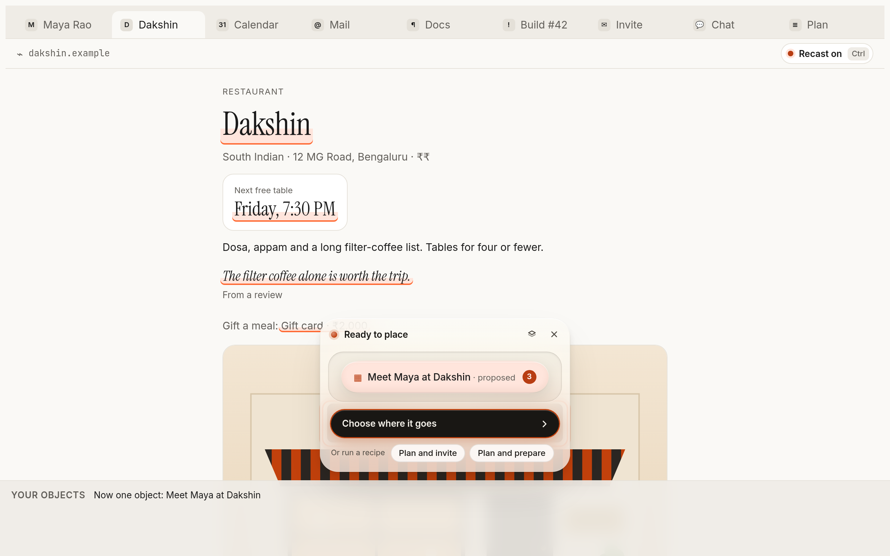
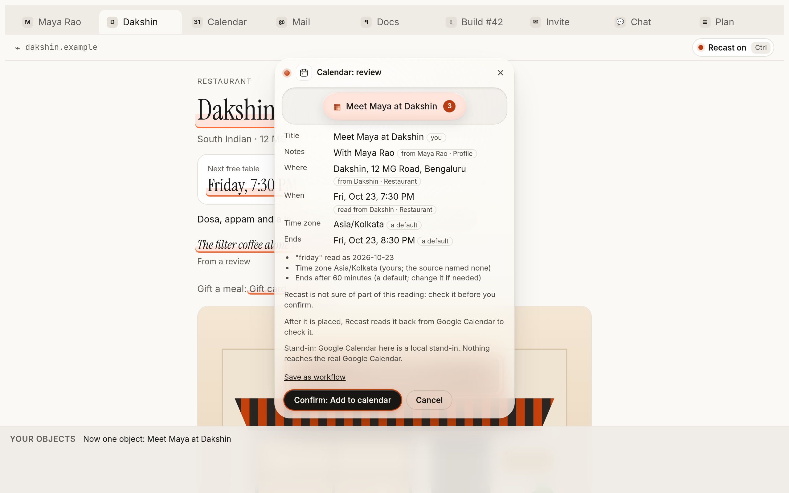
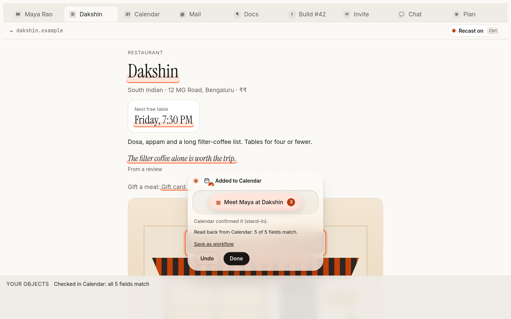
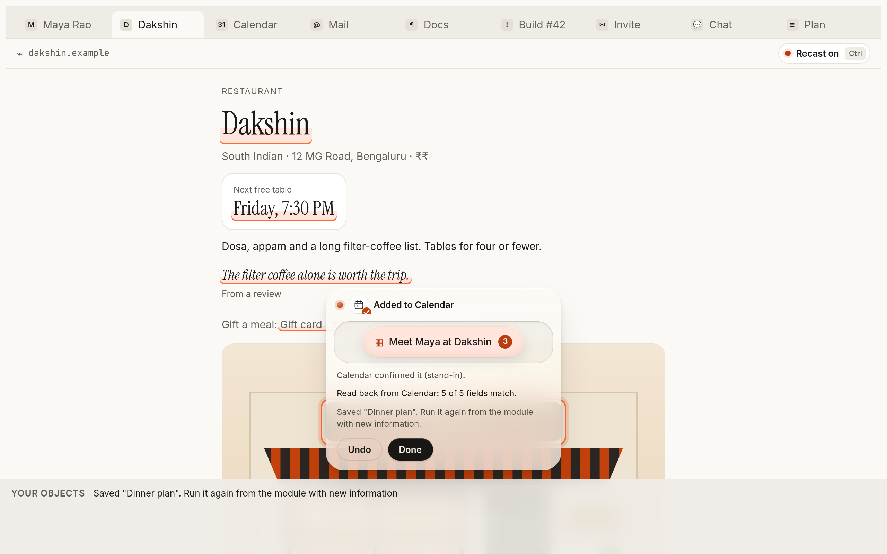
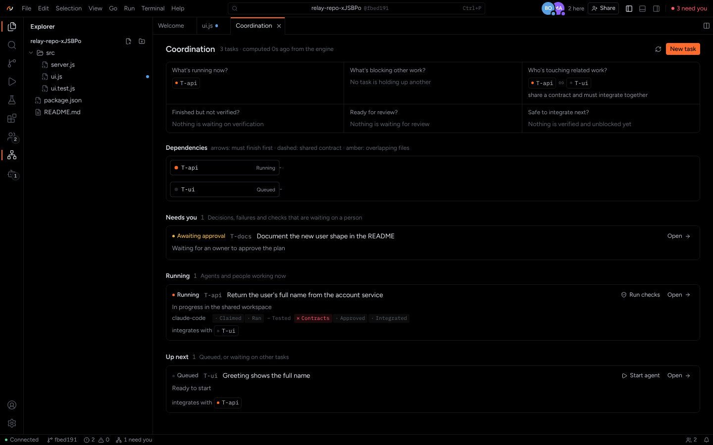
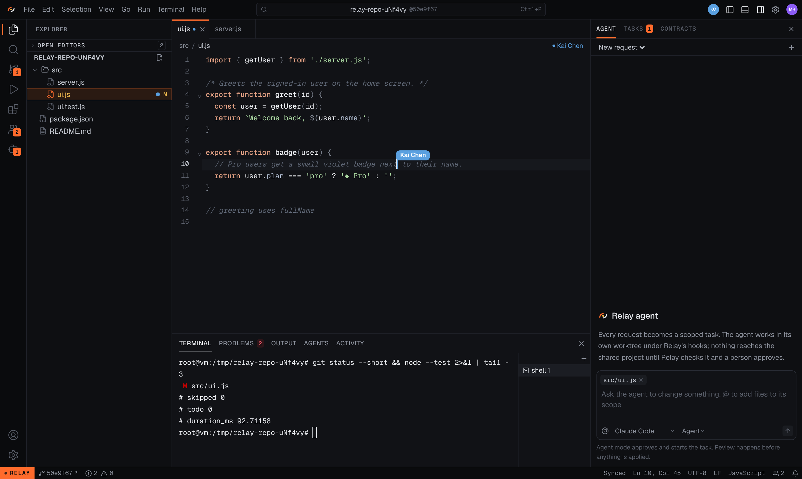

# Recast & Relay

**Nothing important moves without being seen, approved and checked.**

Software now acts for us, moving our plans between apps and writing code beside us. Both are fast, and both quietly get things wrong. Recast and Relay put a person in the loop at the moment that matters, then check the result against reality instead of trusting a "success" message.

| | |
|---|---|
| **Recast**: the context layer between your apps | Select what matters on any page (a person, a time, a place), press the pieces into one object, see exactly what will happen, place it in Google Calendar, Gmail, Tasks, Docs, GitHub or Linear, and Recast reads it back to prove it landed. |
| **Relay**: the integration trust layer for people and coding agents | Two changes can each pass their own tests and still break the project together. Relay rehearses them together before anything is applied, blocks the break, and explains the cause. |

## Try it

**Website: https://shishirbhat.github.io/recast-and-relay/**

| | |
|---|---|
| ▶ **[Try Recast](https://shishirbhat.github.io/recast-and-relay/recast/demo/)** | A playable demo in your browser. No sign-in. The apps in it are local stand-ins; nothing leaves the page. |
| **[Recast](https://shishirbhat.github.io/recast-and-relay/recast/)** | What Recast does, step by step, with screenshots |
| **[Relay](https://shishirbhat.github.io/recast-and-relay/relay/)** | What Relay does, with screenshots of the IDE and the Coordination view |
| ▶ **[Relay walkthrough](https://shishirbhat.github.io/recast-and-relay/relay/walkthrough.html)** | Step through the real experiment: two green changes, one broken project, without and with Relay |
| **[How it works](docs/how-it-works.md)** | The ideas behind both products, in plain language |
| **[APIs](docs/api.md)** | Recast API, SDK and MCP server; Relay's command line, HTTP API and agent tools |

## Recast in four pictures

| Compose | Preview |
|---|---|
|  |  |
| **Verify** | **Repeat** |
|  |  |

## Relay in two pictures

| Coordination | Collaboration |
|---|---|
|  |  |

## Where things stand

We say exactly what has been proven and against what.

| Claim | Proven against |
|---|---|
| Recast captures, composes, previews, places, reads back and undoes | Real Google Calendar for event creation (by hand, on a test account); the other connectors against stand-ins of their APIs |
| Recast runs as a Chrome extension and a desktop app (Mac, Windows, Linux), with an API, SDK and MCP server | Automated tests in real Chromium and Electron on Linux; more than a thousand automated tests in all; Mac and Windows builds made by CI |
| Relay blocks combined breaks before they reach the project | Real Claude Code agents: blocked in 6 of 6 trials; without Relay the break shipped in 6 of 6 |
| Relay explains the cause | "Confirmed" and accurate in 3 of 3 real-agent trials, judged by running the code |
| Use by independent people and teams | **Not yet.** That is the next milestone. |

## About this repository

This is a showcase. **The product source code is private.** Here you will find the demo pages, screenshots and documentation. The Recast demo runs the real interface and engine in your browser (compiled), with stand-ins for the apps it places in.

## Contact

Built by Shishir Bhat ([@shishirbhat](https://github.com/shishirbhat)). For questions, design-partner access to the API, or a live walkthrough of Relay, open an issue in this repository.

© 2026 Shishir Bhat. All rights reserved. See [LICENSE](LICENSE).
